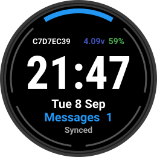
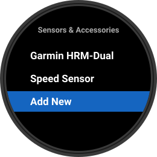
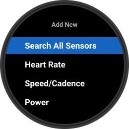
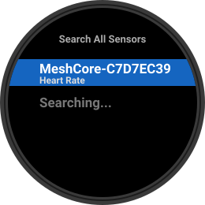
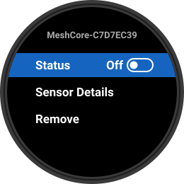
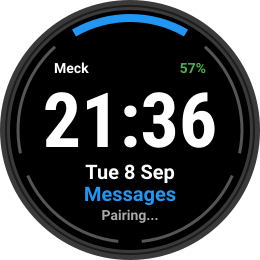
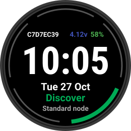

# Meck Garmin

A Connect IQ app for the Garmin fenix 7S that talks straight to a MeshCore
node over Bluetooth. No phone in between: the watch is the client, the node
does the radio and all the mesh cryptography, and the watch shows your
channels on your wrist.

  

The look follows Meck Watch and Meck-P4: a ring menu on the home screen,
one line per message with a marquee for long ones, and the same path
overlay (hops, Heard-by, region) as the Meck firmware family.

## What you need

- A Garmin fenix 7S. The layout is written for its 240 x 240 round screen
  and has only been run on that model.
- A MeshCore companion node running one of the Garmin builds below. A stock
  MeshCore node will not work: Garmin watches cannot enter a Bluetooth PIN,
  so the node has to be built to accept a pairing without one.
- A Mac with VS Code and the Connect IQ SDK to build the app, or a
  `meckgarmin.prg` from the Releases page to copy straight onto the watch.

## Node firmware

The watch needs three things from the node, and each Garmin build provides
them: pairing without a PIN, frames split into 20 byte slices (the watch
never negotiates a bigger Bluetooth packet), and a heart-rate sensor
advertisement so the watch's own sensor menu will pair with it.

| Node | Repository and branch | PlatformIO environment | Watch features |
|---|---|---|---|
| LilyGo T-Deck Max | [pelgraine/Meck](https://github.com/pelgraine/Meck), `main` | `meck_max_ble_garmin` | Everything |
| Heltec V3 | [pelgraine/MeshCore](https://github.com/pelgraine/MeshCore/tree/garmin), `garmin` | `Heltec_v3_companion_radio_ble_garmin` | Standard set |
| Heltec V4 | [pelgraine/MeshCore](https://github.com/pelgraine/MeshCore/tree/garmin), `garmin` | `heltec_v4_companion_radio_ble_garmin` | Standard set |
| Heltec V4 R8 | [pelgraine/MeshCore](https://github.com/pelgraine/MeshCore/tree/garmin), `garmin` | `heltec_v4_r8_companion_radio_ble_garmin` | Standard set |
| Station G2 | [pelgraine/MeshCore](https://github.com/pelgraine/MeshCore/tree/garmin), `garmin` | `Station_G2_companion_radio_ble_garmin` | Standard set |

"Everything" means the Meck build also answers the watch's Meck-only
commands: canned replies mirrored from the node, hop lists and region names
on each message, Heard-by after a send, Discover, and Favourites with
repeater admin. The home screen shows `Synced` once connected.

"Standard set" means the node speaks only the standard MeshCore companion
protocol. The watch detects this and shows `Standard node` on the home
screen. Messages (channels, compose, send), Settings and Trace work.
Discover and Favourites show "Needs a Meck node" when opened, and there
are no canned replies because the node has no slots to fetch them from.

The Garmin builds on the `garmin` branch are the stock companion BLE
environments plus one build flag, `BLE_GARMIN`; the stock environments on
that branch are unchanged. Phones still pair with a Garmin build (see
Security below).

## Installing the app

Either download `meckgarmin.prg` from the
[Releases](https://github.com/pelgraine/Meck-Garmin/releases) page, or
build it yourself. Both end with copying the file onto the watch.

### Copying the app onto the watch

The fenix 7S is an MTP device; it does not appear in the Mac's Finder.

1. Quit Garmin Express completely (check Activity Monitor for its service).
2. Open OpenMTP (openmtp.ganeshrvel.com) with the watch on its cable.
3. Drag `meckgarmin.prg` into `GARMIN/APPS`. Overwrite if asked.
4. Optional log capture: create an empty `GARMIN/APPS/LOGS/MECKGARMIN.TXT`
   (the name must match the `.prg`). Crashes write
   `GARMIN/APPS/LOGS/CIQ_LOG.YML`.
5. Eject. The app appears as "Meck" in the activity list: press Start on
   the watch face and scroll to it. Installed `.prg` files vanish from
   `APPS` on the next mount; that is normal.

### Building it yourself

One-time setup on a Mac:

1. Install VS Code.
2. Install Java (adoptium.net, macOS installer for your chip).
3. Garmin Connect IQ SDK Manager (developer.garmin.com/connect-iq/sdk/):
   sign in, download the latest SDK and make it active, download the
   fenix 7S device files.
4. In VS Code install the "Monkey C" extension by Garmin. Restart.
5. Cmd+Shift+P, "Monkey C: Verify Installation".

Then, each build:

1. File > Open Folder and pick the `garmin` folder inside this repository,
   not the repository's top folder. The Monkey C extension looks for
   `monkey.jungle` in the folder you opened; opening the top folder gives
   "Connect IQ project not found. Be sure your project has a jungle file".
2. Cmd+Shift+P, "Monkey C: Build for Device". The manifest lists only the
   fenix 7S, so it goes straight to the output folder; accept it. The first
   build generates a developer key; keep it.
3. Expect a long list of "Cannot determine if container access is using
   container type" warnings and no ERROR lines. The `.prg` lands in the
   project folder as `meckgarmin.prg`.

## Pairing your node

The fenix will not start a Bluetooth pairing from inside a Connect IQ app
with a node it has not met before, but its own Sensors & Accessories menu
will. So the node is paired there once, as if it were a heart-rate strap.
After that the Meck app uses the bond directly and the sensor entry stays
switched off. The bond survives reflashing the node.

Before you start: flash the Garmin build, switch Bluetooth on at the node,
and turn Bluetooth off on your phone. The node accepts one connection at a
time, and a phone that is already connected stops the node advertising, so
the watch cannot see it.

### Step 1: open the sensor menu

Hold MENU, select **Sensors & Accessories**, then **Add New**.

  

### Step 2: search for the node

Select **Search All Sensors**.

  

### Step 3: pick the node

The node appears under its Bluetooth name, `MeshCore-` followed by the
node's name, listed as a heart-rate sensor. Select it and switch it on. The
watch pairs without asking for a PIN.

  

### Step 4: switch the sensor entry off

This is the step people miss. While the entry is on, the watch keeps the
node as its heart-rate sensor and the Meck app cannot connect. Open the
new entry and set **Status** to **Off**. Leave it in the list; the bond it
made is what the app uses.

  

### Step 5: open Meck

Press Start, choose **Meck**. The home screen status line walks through
`Scanning...` and `Pairing...`. The first time, the watch asks you to
approve the connection because it is an open pairing (no PIN); approve it.

  

### Step 6: done

A Meck node shows its name, battery volts and `Synced`. Any other Garmin
build shows `Standard node` instead.

  
  

From then on, opening the app reconnects on its own.

### If it does not work

- **No sensors found.** Check Bluetooth is on at the node and your phone's
  Bluetooth is off. A free Bluetooth scanner app on the phone should show
  the node advertising a Heart Rate service; if it only shows "Nordic UART
  Service", the node is not running a Garmin build.
- **Paired, but the app sits on `Pairing...`.** The sensor entry is still
  on. Go back to Sensors & Accessories and set its Status to Off.
- **The app shows `Standard node` on a T-Deck Max.** The Max is not running
  the `meck_max_ble_garmin` environment.
- **Reconnect without leaving the app.** Settings, then Reconnect.

## Using the app

Home is button driven: Up and Down move round the ring, Start opens the
highlighted option, Back leaves a screen. Touch is used only on the
keyboard.

- **Messages**: pick a channel, then one line per message. Up and Down
  highlight a line and start a marquee on long ones; Start pauses it. Hold
  Up (or hold a line) opens the path overlay: hops and bytes, receive time,
  the hop list, region, and Reply. Down past the newest message reaches the
  compose bar; Start there opens the keyboard and hold Up opens the canned
  list. Your own sent messages show Heard-by with the repeater hashes that
  echoed them (Meck nodes).
- **Compose**: QWERTY keyboard on the touch screen, Cnd key for canned
  replies, Start sends. Messages are capped at 133 characters.
- **Settings**: node name, firmware, link state, message counts,
  Reconnect, Clear messages.
- **Discover** (Meck nodes): scans for nearby nodes with signal strength
  and hop count; hold to rescan.
- **Trace**: type a path of repeater hashes on the hex pad and run it; the
  result lists each hop's hash and SNR.
- **Favourites** (Meck nodes): your favourite contacts; selecting a
  repeater or room logs in (password typed once) and opens the admin
  screen: View Neighbours, Discover Neighbours, Clock Sync, Send Advert.

Leave the app open to receive messages; a Connect IQ app only runs in the
foreground.

## Security

The node accepts pairing without a PIN while its Bluetooth is on, which
means any device in range could pair with it during that time. This is the
trade-off that makes a Garmin client possible at all. Switch the node's
Bluetooth off when you are not using the watch or a phone with it. On the
T-Deck Max build, a phone pairing with the node is not asked for a PIN
either.

## Repository layout

- `garmin/`: the app (Monkey C). Build from this folder.
- `docs/HANDOFF.md`: the project record: what was proven on hardware, the
  protocol facts the app relies on, decisions, open items.
- `firmware/meck/`: reference copies of the Meck files that carry the
  node-side changes. The live versions are in the Meck repository.
- `images/`: photos of the app on the watch, and the mockups used above.
- `spike/`: the MeckSpike probe that first proved the watch could talk to a
  node (historical).

## Licence

GPL-3.0; see [LICENSE](LICENSE). The node firmware the app talks to
(MeshCore, and Meck on the T-Deck Max) lives in its own repositories under
its own licence (MIT for MeshCore itself).

## Status

Tested on a fenix 7S (Connect IQ 6.0.2, watch firmware 27.198). The
T-Deck Max on `meck_max_ble_garmin` is the daily-use setup: pairing,
channel sync, sending from the watch, Heard-by, the path overlay and the
keyboard are all verified on hardware.
A Station G2 on `Station_G2_companion_radio_ble_garmin` has paired through
the sensor menu and connected in the app; sending from it has not been
tried yet. The three Heltec environments compile and have not yet been
paired on hardware.

Other Garmin models are untested; the app's screens assume a 240 x 240
round display and the manifest lists only the fenix 7S.